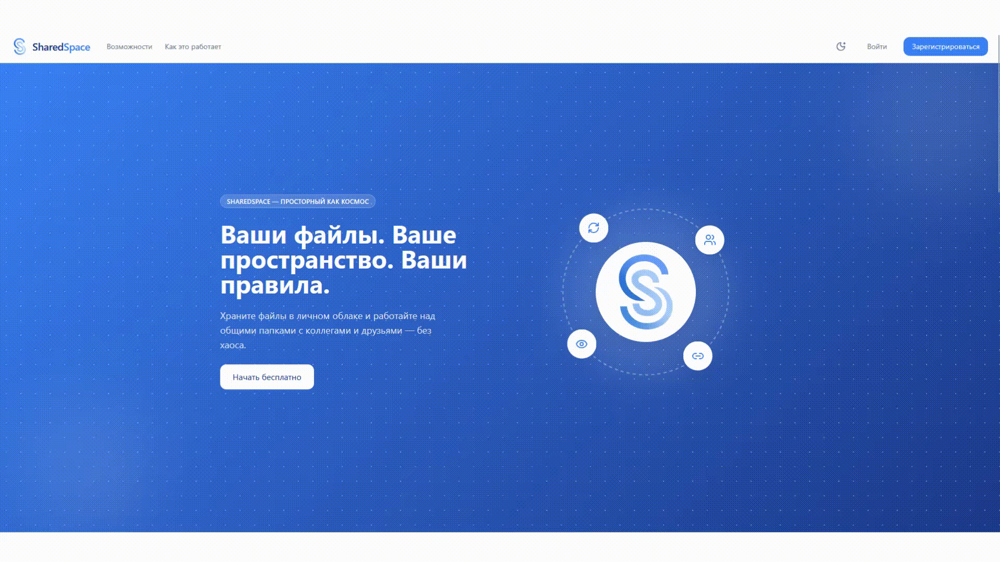

# SharedSpace

Файловый хостинг с совместным доступом.
Загружайте файлы, делитесь ссылками и работайте в общих папках с командой.

---



*Запись сделана с помощью SharedSpace*

---

## Быстрый старт

```bash
git clone https://github.com/TAskMAster339/SharedSpace.git
cd SharedSpace
cp .env.example .env
docker compose up --build
```

После запуска:
- **Фронтенд** → http://localhost
- **API** → http://localhost:8080
- **Swagger** → http://localhost:8080/swagger/

## Разработка

Подробная документация — в папке [`/docs`](/docs).

**Бэкенд:** `make dev` из корня репозитория. Для запуска без Docker см. [настройку окружения](docs/README.md#локальный-запуск-без-docker).
**Фронтенд:** `cd frontend && npm install && npm start`
**Тесты:** `cd backend && go test ./...`

При запуске через `make dev` ссылки подтверждения регистрации и сброса пароля
появляются в логах бэкенда. Откройте логи перед регистрацией или запросом
сброса пароля:

```bash
docker compose -f docker-compose.dev.yml logs -f backend
```

Найдите запись `dev mail:` со своим адресом и откройте ссылку из следующей строки.

### Работа с агентами

Порядок разработки описан в [AGENTS.md](AGENTS.md). Проектные инструкции лежат в [.skills/](.skills/README.md) и доступны сразу после клонирования. Правила редактуры `anti-neuroslog` уже включены в [скилл документации](.skills/documentation/SKILL.md).

Для ревью интерфейса можно установить Impeccable в пользовательское окружение. Для Codex подойдёт команда `npx impeccable install --providers=codex --scope=global`. После установки перезапустите Codex и вызовите `$impeccable` для ревью готовых изменений. Если установщик предложит автоматическую проверку при редактировании, её можно пропустить и запускать ревью вручную в конце работы. Для других агентов используйте [официальную инструкцию Impeccable](https://impeccable.style/docs/).

## Авторы

— [TAskMAster339](https://github.com/TAskMAster339)
— [rrinnaa](https://github.com/rrinnaa)
— [Daria0w0](https://github.com/Daria0w0)
— [MiniLynx13](https://github.com/MiniLynx13)
